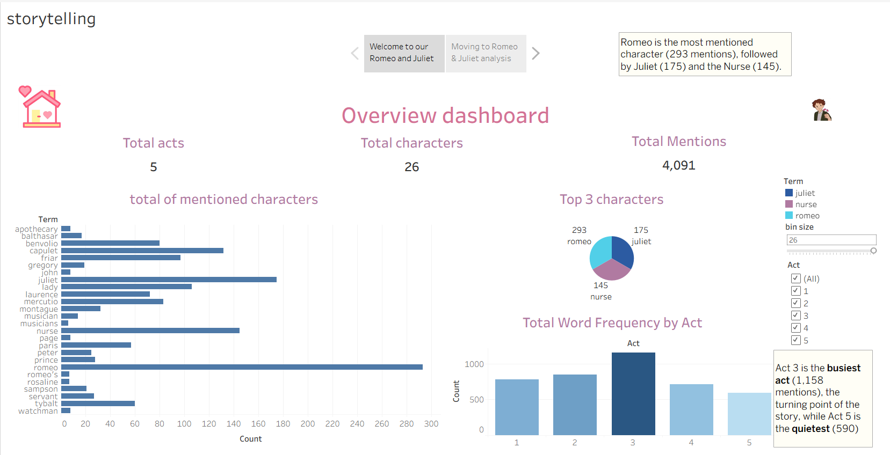
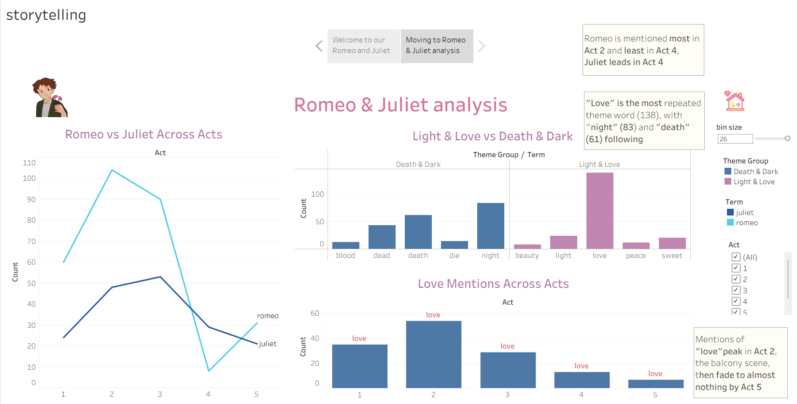
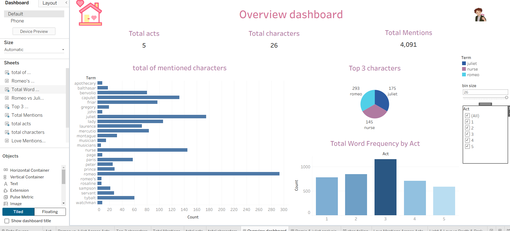
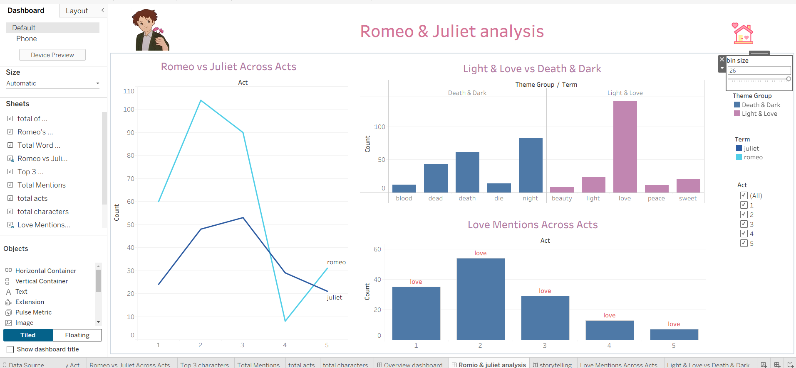

# Romeo-Juliet-Analysis-using-Tableau

Interactive Tableau dashboards and story exploring word frequency by act in Shakespeare's Romeo and Juliet.

## Project Overview
This project analyzes the most frequently used words in each act of Romeo and Juliet. It turns the raw text data into interactive dashboards and a data story that make the patterns in the play easy to explore.

## Questions Answered
- What are the most frequent words in the whole play?
- How does word usage change from one act to another?
- Which words stand out in each act?

## Tools Used
- Tableau (dashboards and story)
- Excel (data source)

## Project Structure
- `Romio and juliet tablaeu.twbx`: the Tableau packaged workbook
- `Screenshoots/`: screenshots of the dashboards and story
- 
### Story

## Dashboards
### Dashboard 1

### Dashboard 2

### Story

## Key Insights
- **Act 3 is the busiest act** with 1,158 mentions and the turning point of the story, while **Act 5 is the quietest** with 590.
- **Romeo is the most mentioned character** (293 mentions), followed by **Juliet** (175) and the **Nurse** (145).
- **"Love" is the most repeated theme word** (138), followed by **"night"** (83) and **"death"** (61).
- Mentions of **"love" peak in Act 2** (the balcony scene) and fade to almost nothing by Act 5.
- **Romeo is mentioned most in Act 2 and least in Act 4**, while **Juliet leads in Act 4**.

## How to Open the Workbook
Download the `.twbx` file and open it with Tableau Desktop or Tableau Public.

## Author
Jana Ahmed Rashad
Data Analyst | SQL, Excel, Python, Power BI, Tableau
